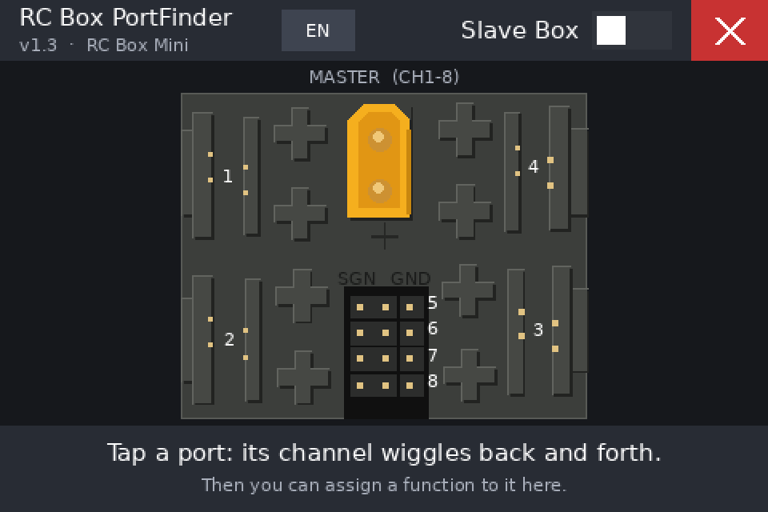
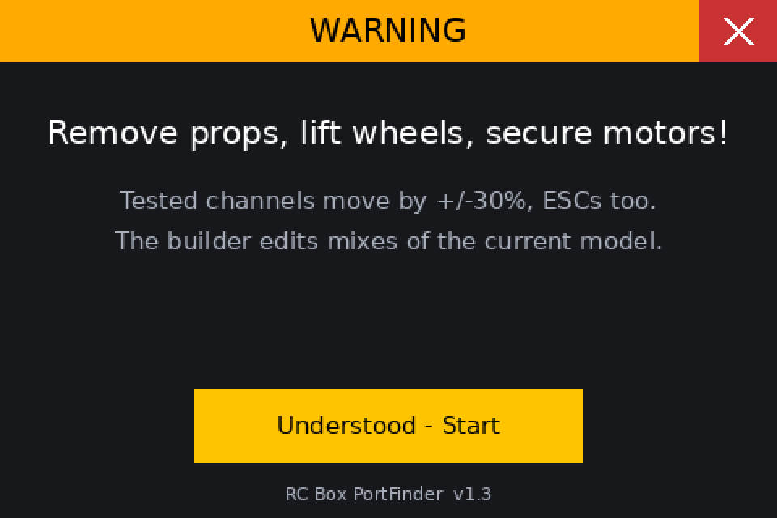
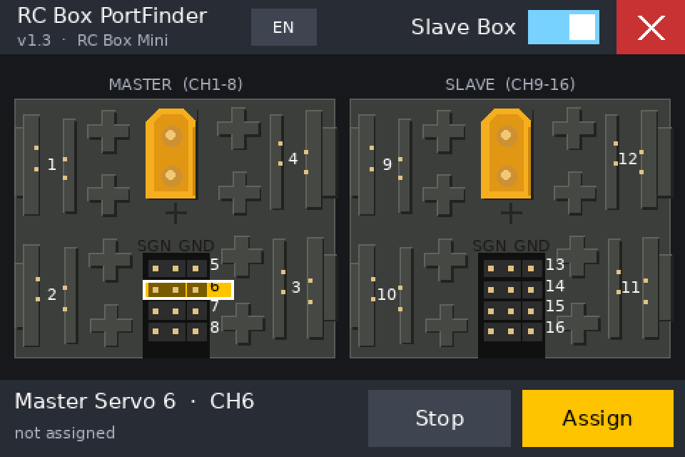
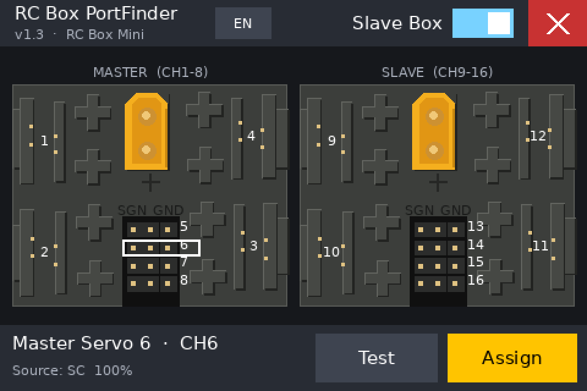

# RC Box PortFinder

**Version 1.3** · EdgeTX Lua tool for the **RC Box Mini** · made for the Flysky Paladin PL18 (EdgeTX)

RC Box PortFinder shows a top view of your RC Box Mini on the transmitter's touchscreen.
Tap a port and the matching channel wiggles back and forth a few times, so you can see
right away which motor or function is connected to it. Then you can assign a stick, pot,
switch or other source to that channel directly, without digging through the mixer menus.

## Features

- **Visual port map.** A to-scale top view of the RC Box Mini with all 8 ports:
  4 Power Functions ports and 4 servo headers.
- **Port test.** Tap a port and its channel moves ±30 % around its current position, 3 times.
- **Slave box support.** One switch adds a second RC Box Mini for channels 9–16.
- **Visual mixer builder.** Assign sticks, pots, switches, logical switches, other channels,
  MAX or global variables to a port. You can also set the weight, invert the direction and
  pick a channel name.
- **Auto detect.** Tap *Detect*, move a stick, pot or switch, and it is selected as the source.
- **Live values.** Every source button shows a small bar with its current value.
- **English and German.** Switch the language with one tap. Your choice is saved.
- **Clean exit.** Temporary test mixes are always removed, even after a crash or power loss.

## Port layout

| Port | Type | Position (top view) | Master box | Slave box |
|------|------|---------------------|------------|-----------|
| 1 | Power Functions | top left | CH1 | CH9 |
| 2 | Power Functions | bottom left | CH2 | CH10 |
| 3 | Power Functions | bottom right | CH3 | CH11 |
| 4 | Power Functions | top right | CH4 | CH12 |
| 5 | Servo header | center, row 1 | CH5 | CH13 |
| 6 | Servo header | center, row 2 | CH6 | CH14 |
| 7 | Servo header | center, row 3 | CH7 | CH15 |
| 8 | Servo header | center, row 4 | CH8 | CH16 |

The yellow XT30 connector at the top center is the main power input.

## Requirements

- A transmitter running **EdgeTX** with a color touchscreen. The tool was developed for the
  Flysky Paladin PL18 (480 × 320).
- One or two RC Box Mini units connected to your receiver.

## Installation

1. Download this repository (green **Code** button → **Download ZIP**) and unzip it.
2. Connect your transmitter to your computer via USB and choose **USB Storage (SD)**,
   or take out the SD card.
3. Copy `SCRIPTS/TOOLS/RCBoxPortFinder.lua` to the folder `/SCRIPTS/TOOLS/` on the SD card.
4. If you used an older version called `PortFinder.lua`, delete it to avoid duplicates.
5. Eject the transmitter or SD card safely and restart the radio if needed.
6. Open the **Tools** menu on the transmitter. **RC Box PortFinder** is now listed there.

The tool creates a small settings file, `/SCRIPTS/TOOLS/RCBoxPortFinder.cfg`, which stores
the language and the slave box setting.

## How to use

### 1. Safety screen

When the tool starts, it shows a safety notice. **Remove propellers, lift wheels off the
ground and secure all moving parts.** During a test, the channel moves even when an ESC
or a drive motor is connected to it. Tap **Understood – Start** to continue.

### 2. Find a port

- Tap any port on the box. It flashes yellow, and the connected motor or servo moves
  back and forth.
- Tap the same port again to stop the test early.
- The bar at the bottom shows the port name, its channel and its current assignment.
- Use the **Slave Box** switch in the title bar to show the second box (CH9–16).
- Use the **EN / DE** button to switch the language.
- Tap the red **X** in the top right corner to close the tool. The PL18 has no RTN key,
  so this button is on every screen.

### 3. Assign a function

Select a port and tap **Assign** to open the builder:

1. **Pick a category** at the top: Sticks, Pots, Switches, Log.Sw, Channels or Other.
2. **Pick a source.** The small bar on each button shows its live value. You can also tap
   **Detect** and move the control you want to use.
3. **Set the options:**
   - **– / +** changes the weight in 10 % steps.
   - **Inverted** reverses the direction.
   - **Replace** deletes the existing mixes on the channel first. Tap it to switch to
     **Add**, which keeps the existing mixes and adds the new one.
   - **Name** cycles through common channel names (Drive, Steer, Light, Crane …).
4. **Test** wiggles the channel again so you can check that it is the right port.
5. **Apply** writes the mix to the current model.

**Clear** removes all mixes from the channel. Tap it a second time to confirm.

Back on the main screen, the bottom bar shows the new assignment.

> **Note:** The builder changes the mixes of the model that is currently selected.
> Mixes created by the tool are named `PF`, so you can find them later in the mixer menu.

## Settings

The values at the top of `RCBoxPortFinder.lua` can be edited with any text editor:

| Setting | Default | Description |
|---------|---------|-------------|
| `amplitude` | `30` | Test movement in percent |
| `cycles` | `3` | Number of back-and-forth movements |
| `halfPeriod` | `25` | Time per direction in 10 ms steps (25 = 250 ms) |
| `layout` | `"rcboxmini"` | Box layout (prepared for more boxes in the future) |

The channel names for the builder can be changed in the `NAMES` table.

## Screenshots

The screenshots were rendered with a simulator. Fonts on the real transmitter may look
slightly different.

## Changelog

- **v1.3**: Renamed to *RC Box PortFinder*. The top view is now redrawn from a photo of the
  real RC Box Mini. Ports 3 and 4 are in the correct positions. Added English and German,
  a version display and the layout system. Removed the "assigned" marker.
