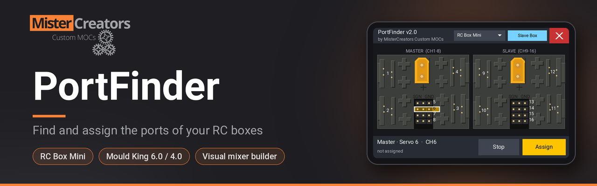

# PortFinder

**Version 2.3** · EdgeTX Lua tool · made by **MisterCreators Custom MOCs** ([mistercreator.de](https://mistercreator.de))

PortFinder shows a top view of your RC box on the transmitter's touchscreen. Tap a port and
the matching channel wiggles back and forth a few times, so you can see right away which motor
or function is connected to it. Then assign a stick, pot, switch or other source to that channel
directly, without digging through the mixer menus.

PortFinder is made for specific boxes. Each box is a small layout file, so more boxes can be
added later.

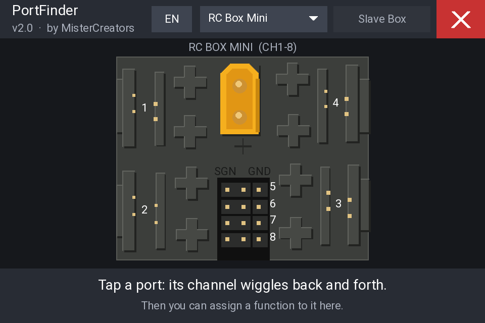

## Supported boxes

Choose your box, then add more boxes with the switches in the title bar. PortFinder remembers
the choice **for each model**.

| Box | Ports | Extra boxes (title bar) | Combinations |
|-----|-------|-------------------------|--------------|
| RC Box Mini | 8 (4 PF, 4 servo) | **Slave Box** switch | 1 or 2 boxes, CH1–16 |
| Mould King 6.0 | 6 PF (A–F) | **+ MK 6.0** and **+ MK 4.0** switches | MK6, 2x MK6, MK6 + MK4, 2x MK6 + MK4 |
| Mould King 4.0 | 4 PF (A–D) | **– 1x +** counter | 1 to 4 boxes |
| Brick Bridge | automatic | – (read from the bridge) | up to 8 devices (BuWizz, SBrick, LEGO hubs), as set in Brick Connect |
| BuWizz 3.0 | 6 (4 PU, 2 PF) | **+ 3.0** and **+ 2.0** switches | 3.0, 2x 3.0, 3.0 + 2.0, 2x 3.0 + 2.0 |
| BuWizz 2.0 | 4 PF | **– 1x +** counter | 1 to 4 BuWizz |
| SBrick / SBrick Plus | 4 PF (A–D) | **– 1x +** counter | 1 to 4 SBrick |
| LEGO Technic Hub | 4 PU (A–D) | **– 1x +** counter | 1 to 4 hubs |
| LEGO City Hub | 2 PU (A, B) | **– 1x +** counter | 1 to 4 hubs (8 with the bridge) |
| LEGO BOOST Move Hub | 2 built-in motors (A, B), 2 PU (C, D) | **– 1x +** counter | 1 to 4 hubs |
| LEGO DUPLO train | motor, light, sound | **– 1x +** counter | 1 to 4 trains |

The boxes use the channels one after the other: with 2x MK 6.0 + MK 4.0 the first MK 6.0 is on
CH1–6, the second on CH7–12 and the MK 4.0 on CH13–16.

> **Mould King boxes** are controlled with a 4in1 multiprotocol module running the
> Mould King protocol (a community firmware). Ports A–F of the first box react to CH1–6,
> further boxes follow on the next channels. Your radio and module must support this
> protocol; PortFinder itself only moves the channels.

<p>
  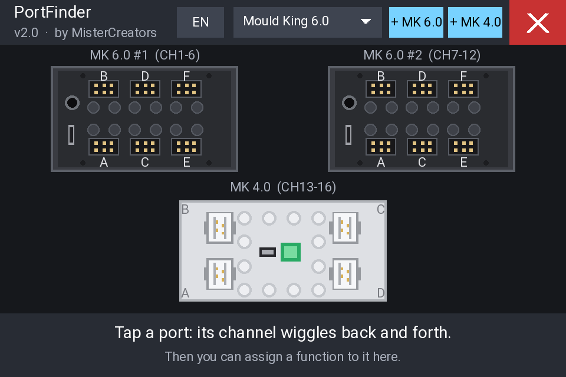
  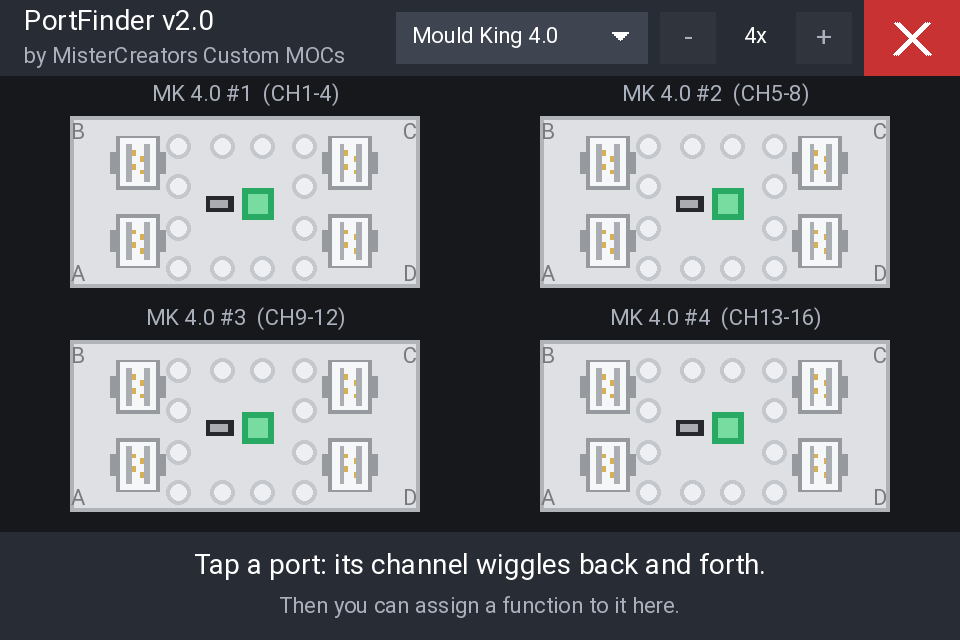
</p>

### Brick Bridge (BuWizz, SBrick, LEGO hubs)

BuWizz, SBrick and LEGO Powered Up hubs are controlled through the **MC Brick Bridge**, an ESP32
that works as the internal CRSF module of the radio and connects to the devices over Bluetooth.
The devices of each model are paired, named and ordered with the **Brick Connect** tool.

- **Brick Bridge** reads the devices of the current model from the bridge: their names, their
  type and their channels, and shows each one with its own layout. You don't need to set up
  anything in PortFinder. If you change the devices in Brick Connect, PortFinder follows right
  away. With more than 4 devices, **<** and **>** in the title bar switch between the pages.
- The fixed setups (**BuWizz 3.0**, **SBrick**, **LEGO Technic Hub** ...) are for use without
  the bridge, or to plan a model. They use the channels one after the other, just like the
  bridge does.

<p>
  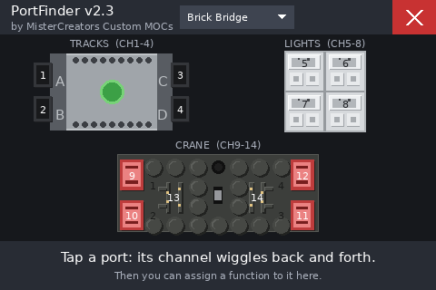
  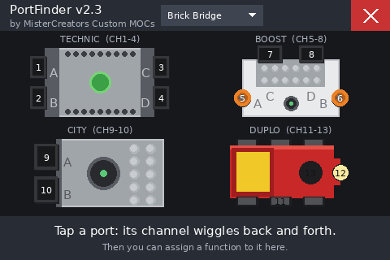
</p>

| Port | BuWizz 3.0 | BuWizz 2.0 | Position (top view) |
|------|------------|------------|---------------------|
| 1 | Powered Up | Power Functions | top left |
| 2 | Powered Up | Power Functions | bottom left |
| 3 | Powered Up | Power Functions | bottom right |
| 4 | Powered Up | Power Functions | top right |
| 5 | Power Functions | – | center left |
| 6 | Power Functions | – | center right |

The BuWizz 3.0 is shown lying on its side, so the four motor ports are in the same corners as on
the RC Box Mini and the BuWizz 2.0.

| Device | Ports and channels | Position (top view) |
|--------|--------------------|---------------------|
| SBrick / SBrick Plus | A, B, C, D | A top left, B top right, C bottom left, D bottom right |
| LEGO Technic Hub | A, B, C, D | A, B on the left end, C, D on the right end |
| LEGO City Hub | A, B | both on the left end (hub lying on its side) |
| LEGO BOOST Move Hub | A, B built-in motors, C, D | A left, B right, C and D on the rear end |
| LEGO DUPLO train | 1 motor, 2 light, 3 sound | wheels, front light, chimney |

> The port positions of the SBrick and the LEGO hubs are listed at the top of each layout file,
> so they are easy to adjust.

<p>
  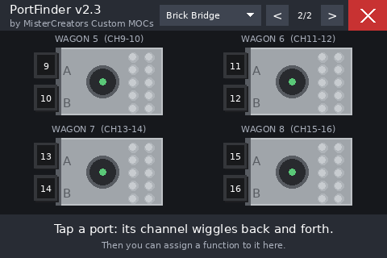
  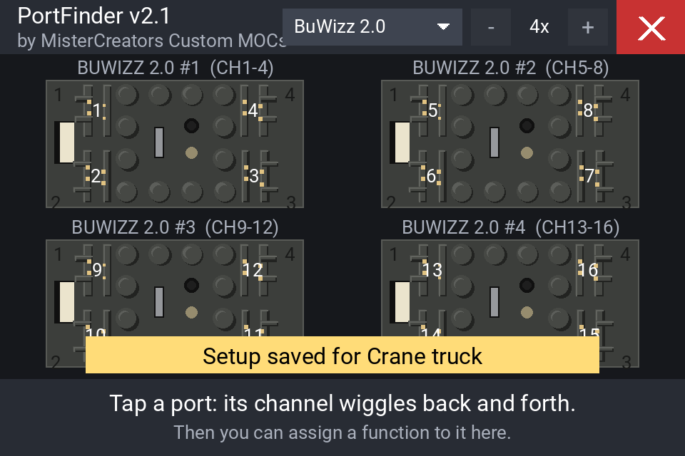
</p>

## Features

- **Visual port map:** a top view of each box with all its ports.
- **Port test:** tap a port and its channel moves ±30 % around its current position, 3 times.
- **Box choice per model:** one box, or more boxes added with a switch, saved per model.
- **Visual mixer builder:** assign sticks, pots, switches, logical switches, other channels,
  MAX or global variables, with weight, invert and channel name.
- **Auto detect:** tap *Detect*, move a stick, pot or switch, and it is selected.
- **English and German:** switch with one tap in the box list.
- **Clean exit:** temporary test mixes are always removed, even after a crash or power loss.

## Requirements

- A transmitter running **EdgeTX** with a colour touchscreen. Developed on a Flysky Paladin
  PL18 (480 × 320).
- The RC box(es) of your setup connected to your receiver or multiprotocol module.
- For **Brick Bridge**: the MC Brick Bridge 2.0 with **Model → Internal RF → CRSF** switched on.

## Installation

1. Download this repository (green **Code** button → **Download ZIP**) and unzip it.
2. Connect your transmitter via USB (**USB Storage (SD)**) or take out the SD card.
3. Copy the folder `SCRIPTS` to the SD card, so you get:
   ```
   /SCRIPTS/TOOLS/PortFinder.lua
   /SCRIPTS/PortFinder/layouts/rcboxmini.lua
   /SCRIPTS/PortFinder/layouts/mk60.lua
   /SCRIPTS/PortFinder/layouts/mk40.lua
   /SCRIPTS/PortFinder/layouts/buwizz3.lua
   /SCRIPTS/PortFinder/layouts/buwizz2.lua
   /SCRIPTS/PortFinder/layouts/sbrick.lua
   /SCRIPTS/PortFinder/layouts/technichub.lua
   /SCRIPTS/PortFinder/layouts/cityhub.lua
   /SCRIPTS/PortFinder/layouts/movehub.lua
   /SCRIPTS/PortFinder/layouts/duplotrain.lua
   ```
4. **Updating from v1.x:** delete `/SCRIPTS/TOOLS/RCBoxPortFinder.lua` (and `PortFinder.lua`
   from v1.0), otherwise the old tool stays in the menu.
5. Open the **Tools** menu on the transmitter and start **PortFinder**.

The tool saves its settings (language and the boxes of each model) in
`/SCRIPTS/PortFinder/PortFinder.cfg`.

## How to use

### 1. Safety screen


**Remove propellers, lift wheels off the ground and secure all moving parts.** During a test
the channel moves even when an ESC or a drive motor is connected. Tap **Understood – Start**.

**Choose box** next to it opens the box list right away. If PortFinder got stuck the last time
it showed the boxes of a model, it opens the box list by itself on the next start, so you can
always switch to another setup.

### 2. Choose your boxes

<p>
  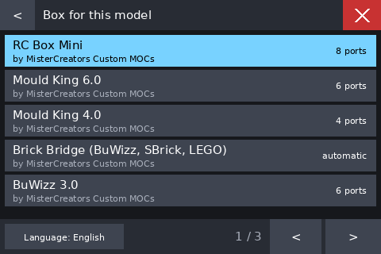
  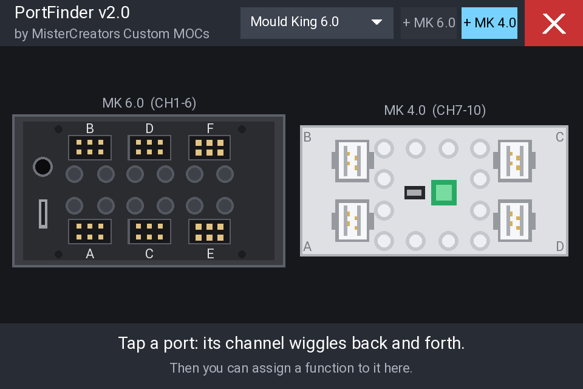
</p>

Tap the box button in the title bar (it shows the current box) and pick your box. Next to it
you find the switches for extra boxes: **Slave Box** for the RC Box Mini, **+ MK 6.0** and
**+ MK 4.0** for the Mould King 6.0, and a **– 1x +** counter for the Mould King 4.0.
Everything is saved for the current model. The button at the bottom of the box list switches
the language between English and German.

### 3. Find a port

<p>
  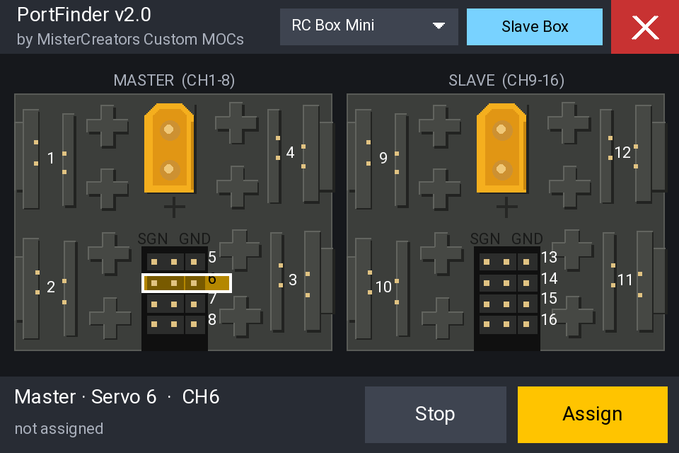
  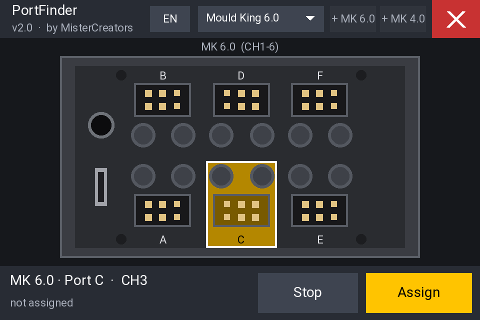
  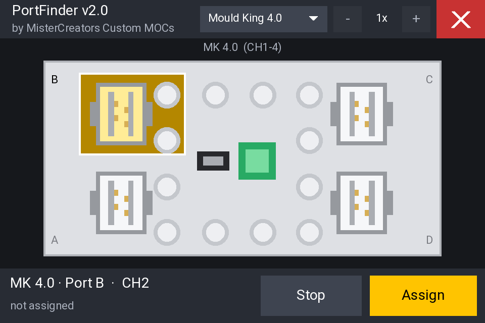
</p>

- Tap any port. It flashes yellow and the connected motor or servo moves back and forth.
  On Mould King boxes the two studs next to a port belong to it.
- Tap the same port again to stop the test early.
- The bar at the bottom shows the box, the port, its channel and its current assignment.
- RC Box Mini shows the channel number at each port. Mould King boxes show the port letter
  printed on the box; the channels are shown above each box.
- The red **X** closes the tool on every screen.

### 4. Assign a function

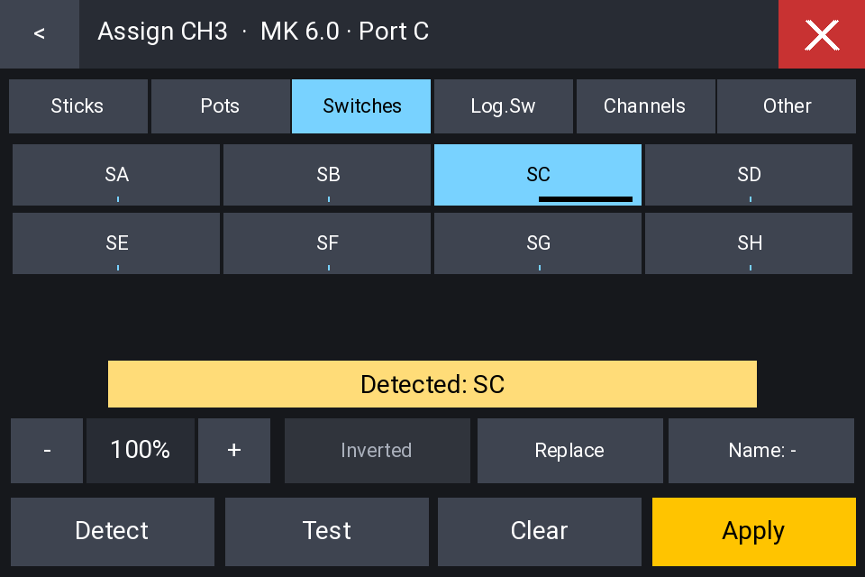

Select a port and tap **Assign**:

1. **Pick a category:** Sticks, Pots, Switches, Log.Sw, Channels or Other.
2. **Pick a source.** The small bar on each button shows its live value. Or tap **Detect**
   and move the control you want to use.
3. **Options:** **– / +** changes the weight in 10 % steps, **Inverted** reverses the
   direction, **Replace** / **Add** decides whether existing mixes are deleted first,
   **Name** cycles through common channel names.
4. **Test** wiggles the channel again, **Apply** writes the mix to the current model.

**Clear** removes all mixes from the channel (tap twice to confirm).

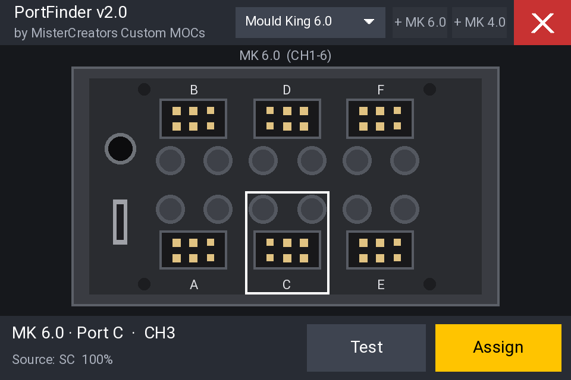

> The builder changes the mixes of the model that is currently selected. Mixes created by the
> tool are named `PF`.

## Settings

At the top of `PortFinder.lua`:

| Setting | Default | Description |
|---------|---------|-------------|
| `amplitude` | `30` | Test movement in percent |
| `cycles` | `3` | Number of back-and-forth movements |
| `halfPeriod` | `25` | Time per direction in 10 ms steps |

## Adding a box (layout files)

Every box is one file in `/SCRIPTS/PortFinder/layouts/`. PortFinder loads all files in this
folder and lists their setups. To add a box, copy one of the existing files and change it.
A layout file returns a table:

| Field | Description |
|-------|-------------|
| `id`, `name`, `short` | Unique id, full name, short name for titles |
| `author`, `version` | Shown in the setup list |
| `x0`, `y0`, `w`, `h` | Area of the box in layout units (pixels of a top-view photo work well) |
| `channels` | Channels one box uses |
| `numbers` | `"channel"` shows channel numbers at the ports, `"label"` shows `port.label` |
| `numColor` | Colour of the port numbers (optional) |
| `ports` | List of ports: `name`, `label`, `kind`, `ch` (1…channels), `hit = {x1, y1, x2, y2}`, `num = {x, y}`, `align`, `dx`, `dy` |
| `draw(g)` | Draws the box |
| `drawPort(g, port, active)` | Draws one port (optional) |
| `order` | Position in the box list |
| `extras` | Extra boxes for the title bar: `{ label, device = "layout id", max }`. `max` 1 = switch, more = counter |
| `titles` | Names of the boxes when several of the same box are used, e.g. `{"Master", "Slave"}` (optional) |
| `selectable` | `false` hides the box from the list, e.g. a box that is only used as an extra (optional) |

The `g` table passed to `draw` has helpers that work in layout units and scale automatically:
`g.R` (filled rectangle), `g.frame`, `g.line`, `g.raised`, `g.pin`, `g.circle`, `g.ring`,
`g.chamfer`, `g.text`, plus `g.PX` / `g.PY` to convert to screen pixels.

Fixed setups show at most 4 boxes. The Brick Bridge setup shows up to 8 devices, 4 per page.
An extra box only appears when its layout is installed. A bridge device whose layout is missing
is shown as a simple row of ports.

## Screenshots

The screenshots were rendered with a simulator running the PortFinder code. Fonts on the real
transmitter may look slightly different.

## Changelog

- **v2.3**: Fixed: 4x BuWizz 2.0 (and other big setups) made the tool hang on the radio. Boxes
  are now prepared once and then only redrawn, which needs about 80 % less computing time.
  **Choose box** button on the safety screen, and the box list opens by itself after a start
  that got stuck. SBrick layout redrawn from a photo.
- **v2.2**: Layouts for SBrick / SBrick Plus, LEGO Technic Hub, City Hub, BOOST Move Hub and
  DUPLO train. The setup **BuWizz (Bridge)** is now **Brick Bridge** and shows up to 8 devices
  of the MC Brick Bridge 2.0 (BuWizz, SBrick, LEGO hubs) on two pages.
- **v2.1**: BuWizz 2.0 and BuWizz 3.0 layouts. New setup **BuWizz (Bridge)**: the BuWizz of the
  model, their names and channels are read live from the MC BuWizz Bridge.
- **v2.0**: Renamed to *PortFinder*. Layouts are separate files. New layouts for Mould King 6.0
  and Mould King 4.0. Box list and switches for extra boxes in the title bar (up to 4 boxes),
  saved per model.
- **v1.3**: *RC Box PortFinder*: top view redrawn from a photo of the RC Box Mini, English and
  German, version display.

## Credits

PortFinder is made by **MisterCreators Custom MOCs** ([mistercreator.de](https://mistercreator.de)).
Layout files by other authors show their name in the setup list.
